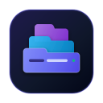
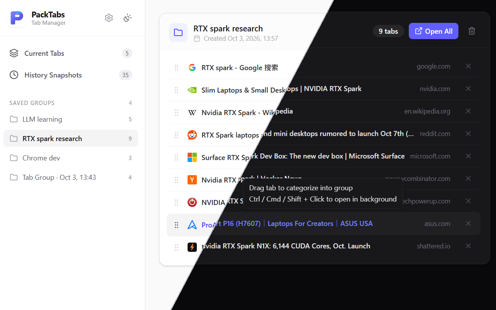

# PackTabs Extension 

> **Save open tabs for unfinished tasks in one click, banish bookmark clutter, and restore your workspace instantly.**

[](https://github.com/topos-lab/packtabs-extension/actions/workflows/ci.yml)
[](https://github.com/topos-lab/packtabs-extension/releases)
[](https://github.com/topos-lab/packtabs-extension/security/dependabot)
[](LICENSE)
[](https://developer.chrome.com/docs/extensions/mv3/intro/)
[](https://wxt.dev/)
[](https://vuejs.org/)
[](https://tailwindcss.com/)
[](https://www.typescriptlang.org/)
[](https://bun.sh/)
[](https://vitest.dev/)
[](https://makeapullrequest.com)

PackTabs is a productivity-first Manifest V3 browser extension built with the WXT Framework, Vue 3, and Tailwind CSS v4.

## 📥 Installation

Install directly from your preferred browser extension store:

| Browser | Store Link | Status |
| :--- | :--- | :--- |
| **Google Chrome / Chromium** | [Chrome Web Store](https://chromewebstore.google.com/detail/packtabs/mpjjbfgjjbphemiklfoojlogcmjdkjjp) | ✅ Available |
| **Mozilla Firefox** | [Firefox Add-ons (AMO)](https://addons.mozilla.org/zh-CN/firefox/addon/packtabs-task-tab-manager/) | ✅ Available |
| **Microsoft Edge** | Available via Chrome Web Store | ✅ Compatible |

> 💡 **Tip**: After installation, click the puzzle piece icon (🧩) in your browser toolbar and pin **PackTabs** () for instant one-click access!

> 📘 **User Guides**: [English User Guide](docs/USER_GUIDE.md) | [中文使用指南](docs/USER_GUIDE_ZH.md)



When working on multitasking projects, research topics, or troubleshooting issues, tabs easily pile up. Bookmarking them one by one is tedious, slow, and clutters your permanent browser bookmarks with temporary links. PackTabs eliminates this friction: package all open tabs from an unfinished task into an organized group in one click, cleanly close the window to clear your mind and free browser memory, and restore your entire work context whenever you're ready to pick up where you left off.

## Why PackTabs?

- ⚡ **Task-Oriented Session Capture**: Staging and saving 10+ open tabs takes just one click—no more tedious one-by-one bookmarking.
- 🧹 **Instant Focus & Memory Relief**: Save current tabs and close the window automatically to eliminate multitasking clutter and free up system RAM.
- 🚀 **One-Click Workspace Restoration**: Reopen entire task sessions or click any tab item directly to launch it (`Ctrl/Cmd/Shift+Click` or middle-click for background opening).
- 🛡️ **Zero-Loss History Snapshots**: Closed a window or quit the browser unexpectedly? Open sessions are automatically captured as deduplicated history snapshots with configurable retention limits.
- 🎯 **Flexible Drag & Drop Categorization**: Move or organize tabs across task groups effortlessly on the sidebar.

## Core Features

- **Quick Action Popup**: Click the toolbar icon to either save your current window in 1 click or launch any Saved Group immediately (with `↗` new-window launch).
- **One-Click Session Capture**: Save all open tabs in the current window with an inline "Close window after save" switch ("Save & Exit" by default).
- **Multi-Window Isolation**: Each browser window keeps its own dashboard tab and captures only its own open tabs.
- **Smart Auto-Naming**: Intelligent timestamps (e.g. `Tab Group · Oct 2, 18:40`) if no group name is provided.
- **Automatic History Snapshots**: Silently captures closed-window tabs with latest-wins deduplication, configurable retention limits (`10` / `25` / `50` / `100`), and inline header save-to-group conversion.
- **Dual-Mode Restoration & Undo Toasts**: Open tabs in the current window or click `↗` (`Shift+Click`) to open in a new window; delete groups or items instantaneously with 5-second Undo toast recovery.
- **Startup Restorer**: Minimalist 2-column session restoration view on browser cold launch (`?mode=startup`) with hover-only cleanup and drag-to-group organization.
- **Drag-and-Drop Categorization**: Drag any tab across groups (`Current Tabs` / `Saved Groups` / `Startup Restorer`); history snapshots copy cleanly while saved groups move atomically.
- **Direct & Background Tab Opening**: Click any tab row to open it immediately, or use `Ctrl/Cmd/Shift + Click` (or middle-click) to open silently in the background.
- **Tri-State Theme System**: Seamless Light, Dark, and Auto (System) themes with cached first-paint rendering across Dashboard and Popup.
- **Accessible & Lightweight UI**: Headless accessible primitives powered by Radix Vue and styled with Tailwind CSS v4 (no bulky UI frameworks).
- **Theme-Aware Tooltips & Neutral Toast Cards**: Fast `300ms` theme-adaptive tooltips on action buttons, overflow-only tooltips on truncated tab titles, and neutral floating Undo toasts.
- **Configurable Shortcut**: Quick launcher configurable via browser settings (default: `Alt+Shift+K` on Windows/Linux, `Command+Shift+K` on macOS).
- **Robust Storage Architecture**: Sharded storage under `local:tabGroups` bypassing Chrome Sync's 8KB quota, paired with `sync:settings` for cross-device preferences.

## Technology Stack

- **Extension Framework**: [WXT Framework](https://wxt.dev/) (v0.21.x) with Vite 8 bundler
- **Frontend Stack**: [Vue 3](https://vuejs.org/) (Composition API with `<script setup>`), [Pinia 4](https://pinia.vuejs.org/)
- **Styling & UI Primitives**: [Tailwind CSS v4](https://tailwindcss.com/), [Radix Vue](https://www.radix-vue.com/), [Lucide Vue Next](https://lucide.dev/)
- **Language**: [TypeScript](https://www.typescriptlang.org/) (Strict mode)
- **Runtime & Package Manager**: [Bun](https://bun.sh/)
- **Testing**: [Vitest](https://vitest.dev/), [@vue/test-utils](https://test-utils.vuejs.org/), [fast-check](https://fast-check.dev/) (Property-based testing)

## Development

### Prerequisites

- [Bun](https://bun.sh/) (v1.1+)
- Chrome, Edge, or Firefox for local testing

### Setup

```bash
# Install dependencies
bun install

# Prepare WXT environment
bun run postinstall
```

### Common Commands

```bash
# Start development server with HMR for Chrome
bun run dev

# Start development server for Firefox
bun run dev:firefox

# Build production extension for Chrome MV3 / Firefox MV3
bun run build
bun run build:firefox

# Run complete quality gate (type check + lint + 300+ Vitest tests)
bun run check

# Package extensions into release zips (.output/*.zip)
bun run zip
bun run zip:firefox
```

## Release & Documentation

PackTabs uses an **Even/Odd versioning scheme** (odd minors for development, even minors for store releases) with automated GitHub Actions CI, release tagging, and Chrome Web Store / Firefox AMO publishing:

- **[Release Process, Store Credentials & CI/CD](docs/RELEASING.md)** — `bun run release`, GitHub Actions (`ci.yml`, `release.yml`, `dependabot.yml`), and store secrets setup
- **[Browser Store API Key Guide](docs/STORE_API_KEY_GUIDE.md)** — Step-by-step guide for Chrome Web Store & Firefox AMO API credentials
- **[Architecture Guide](docs/architecture.md)** — Storage mutexes, concurrency, and extension lifecycle design
- **[Changelog](CHANGELOG.md)** — Version history and release notes

## Directory Structure

```
packtabs-extension/
├── entrypoints/
│   ├── background.ts              # Service worker (session sync, snapshot recovery, commands)
│   ├── popup/                     # Compact 280px toolbar popup (save trigger & group launcher)
│   └── dashboard/                 # Full-page manager & startup restorer app (Vue 3)
│       ├── App.vue                # Main dashboard shell
│       ├── main.ts                # App mount entry
│       └── style.css              # Global styles & Tailwind entry
├── components/
│   ├── ui/                        # Reusable accessible UI primitives (Badge, Button, Card, Modal, Input, Toast, Tooltip)
│   ├── CollectionDetail.vue       # Dedicated saved group detail view
│   ├── SettingsModal.vue          # Preferences, theme, language, startup & history retention settings
│   ├── StartupRestorer.vue        # Dedicated cold-start session restorer view
│   ├── TabGroupCard.vue           # Interactive history/group card
│   ├── TabGroupList.vue           # Timeline-categorized groups list
│   └── TabItemRow.vue             # Draggable tab row with overflow-only tooltip
├── stores/
│   └── useTabStore.ts             # Pinia store synced with mutex-locked storage
├── composables/
│   ├── useI18n.ts                 # Multi-language i18n (en, zh_CN, zh_TW)
│   ├── useSettings.ts             # Atomic sync:settings state & cross-window watcher
│   ├── useTheme.ts                # Tri-state theme manager + cached first-paint helper
│   └── useToast.ts                # Floating toast notifications with Undo actions
├── utils/
│   ├── dashboardLauncher.ts       # Per-window dashboard launch & focus manager
│   ├── date.ts                    # Locale-aware cached date formatters & safe sorting
│   ├── init-app.ts                # App initialization
│   ├── keyboard.ts                # IME composition keyboard guard
│   ├── storage.ts                 # Web Locks / mutex-serialized chrome.storage service
│   └── tabManager.ts              # Browser tabs capture, URL sorting, restore & favicon helpers
├── types/
│   ├── env.d.ts                   # Build timestamp declaration
│   ├── TabGroup.ts                # Core tab and group models
│   └── Storage.ts                 # Storage schemas and items
└── tests/
    ├── unit/                      # Component and utility unit tests
    └── property/                  # fast-check property-based tests
```

## License

Released under the [MIT License](LICENSE).

## Privacy Policy

PackTabs operates with a 100% offline, privacy-by-default architecture. All saved tab groups and configurations stay strictly inside your local browser storage.  
Read the full [Privacy Policy](PRIVACY_POLICY.md) or visit the hosted version at [https://topos-lab.github.io/packtabs-extension/](https://topos-lab.github.io/packtabs-extension/).
