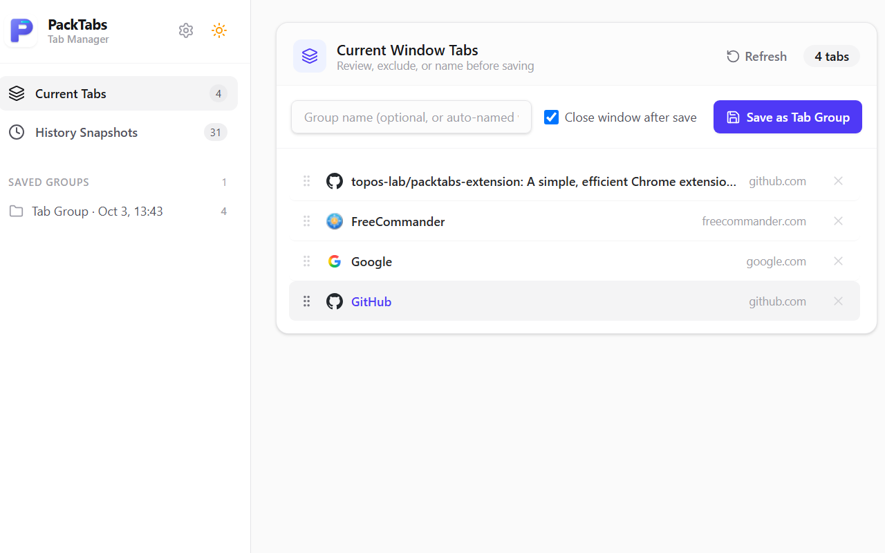
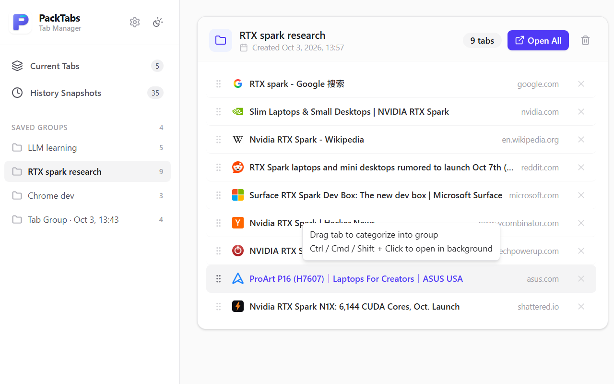
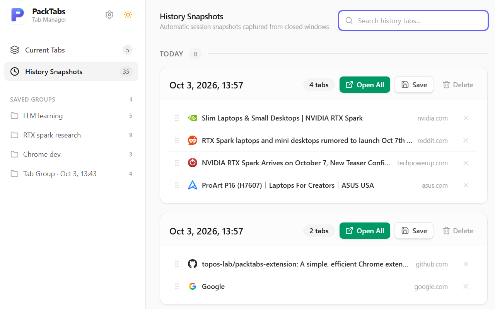
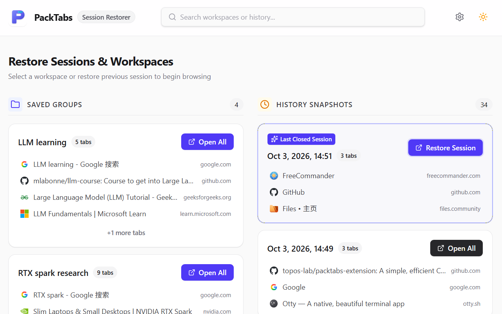
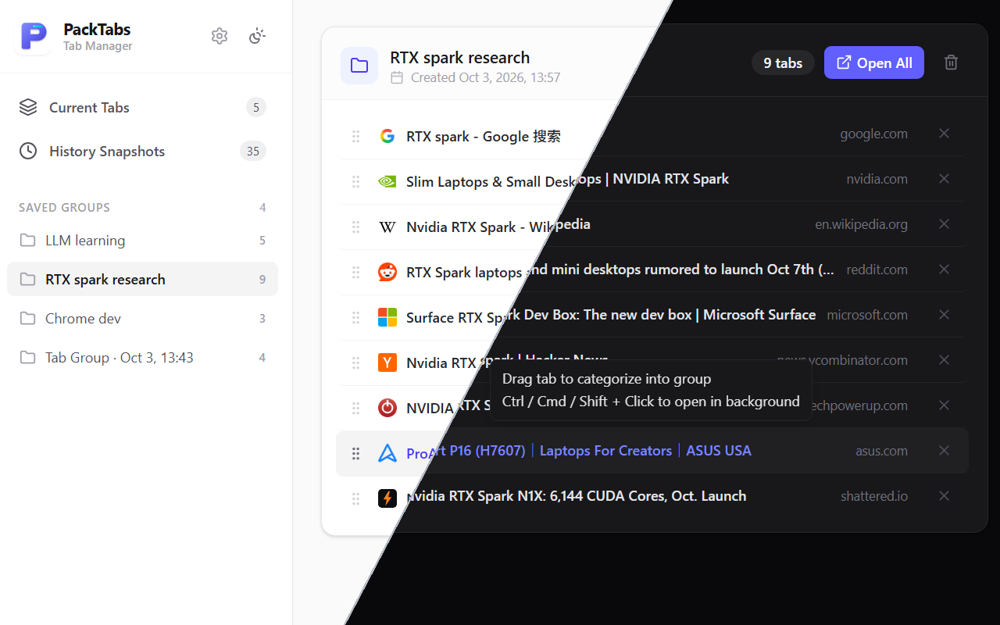

#  PackTabs User Guide (User Guide)

🌐 **Language / 语言**: English | [简体中文](USER_GUIDE_ZH.md)

> **Version**: v1.6.0  
> **Supported Browsers**: Google Chrome / Mozilla Firefox / Microsoft Edge and Chromium-based browsers  
> **Extension Stores**: [Chrome Web Store](https://chromewebstore.google.com/detail/packtabs/mpjjbfgjjbphemiklfoojlogcmjdkjjp) | [Firefox Add-ons](https://addons.mozilla.org/zh-CN/firefox/addon/packtabs-task-tab-manager/)

---

## 1. Why PackTabs?

Modern web multitasking often leads to two major productivity pitfalls:

1. **The Fear of Closing the Browser**: Unfinished research, debugging tabs, or shopping comparisons linger in 30–80+ open tabs, eating up gigabytes of system memory and overwhelming your focus.
2. **The Bookmark Bar Graveyard**: Saving temporary working tabs to your permanent bookmark bar clutters your bookmarks with disposable links that you rarely organize and hesitate to delete.

**The PackTabs Solution**:
A **task-oriented** tab and workspace manager. When you finish a work session or switch projects, package every open tab in your current window into a dedicated group with one click. Clear your browser to regain mental clarity, and restore your full workspace context instantly whenever you're ready.

---

## 2. Quick Start

### 1. Launching PackTabs

- **Click the Toolbar Icon (Quick Action Popup)**: Clicking the **PackTabs** icon () opens a compact `280px` launcher (pin 📌 it from the 🧩 extension menu if hidden):
  - Click **Save current window tabs** at the top to jump straight to Current Window Tabs in the active window.
  - Click any **Saved Group** name to restore it into your current window in 1 click (or `Shift+Click` / hover `↗` to open it in a new window).
- **Global Keyboard Shortcut** (opens the full Dashboard):
  - Windows / Linux: `Alt + Shift + K`
  - macOS: `Command + Shift + K`

> [!TIP]
> You can customize your keyboard shortcut at any time by visiting `chrome://extensions/shortcuts` in Chromium browsers, or by clicking the shortcut configuration link directly inside the extension's Settings modal.

---

## 3. Core Feature Walkthrough (Core Features)

---

### Feature 1: Current Window Staging & One-Click Tab Packing

#### 📖 How It Works

When you open PackTabs, you're greeted with the **Current Window Tabs** view:

- **Live Preview**: Open tabs in the active window appear sorted cleanly by URL with crisp favicons and domains.
- **Selective Exclusion**: Click the `✕` icon on any irrelevant tab (e.g., a search engine homepage) to exclude it before saving — a 5-second Undo toast lets you restore it right back.
- **Custom Naming**: Type a task or project name (e.g., `LLM learning`, `RTX spark research`). If left blank, PackTabs automatically assigns an intelligent timestamp name.
- **Save & Auto-Close**: Toggle the inline **"Close window after save"** switch right beside the primary CTA — when enabled (default), the button reads **Save & Exit** and stores all tabs while cleanly closing the window.

_Figure 1: Capture all task tabs in one click · Free memory instantly_

---

### Feature 2: Instant Workspace Restoration & Silent Background Tabs

#### 📖 How It Works

Switch to the **Saved Groups** view in the sidebar:

- **One-Click Workspace Restore**: Click **Open All** to reopen tabs in your current window (`Shift+Click` opens in a new window), or click the adjacent `↗` icon button to launch them together in a brand-new focused window.
- **Open Individual Tabs in Background**: Hold `Ctrl` (or `Cmd` / `Shift` on Mac) while clicking a tab item (or middle-click) to load it quietly in the background without stealing focus.
- **Edit & Undo-Safe Deletion**: Hover over the card header to reveal the edit icon for renaming; clicking the trash icon deletes immediately with a **5-second Undo toast** in the bottom-right corner.

_Figure 2: Restore entire workspaces in seconds · Open individual tabs silently in background_

---

### Feature 3: Automatic History Snapshots (Zero Data Loss)

#### 📖 How It Works

Ever accidentally clicked the browser's top-right `✕` and lost crucial reference tabs?

- **Automatic Failsafe**: PackTabs runs an active listener service. Whenever an entire browser window closes, it **automatically captures and deduplicates all open tabs into a History Snapshot**.
- **Chronological Archive**: Access the **History Snapshots** view in the sidebar, neatly organized by Today, Yesterday, and Previous 7 Days.
- **One-Click Inline Save**: Hover over a snapshot's header and click the bookmark-plus icon next to the timestamp to name it inline and convert it into a permanent Saved Group.

_Figure 3: Window closed unexpectedly? Automatic snapshots record all tabs, ready to recover or save as permanent groups_

---

### Feature 4: Browser Startup Restorer

#### 📖 How It Works

Pick up right where you left off every morning:

- Enable "Restore on Startup" in Settings.
- When opening a fresh browser instance, PackTabs displays a calm 2-column startup screen highlighting your **Last Closed Session** alongside Saved Groups.
- Click **Restore Session** / **Open All** (or `↗` for a new window) to resume cleanly, press `/` to search, or hover over a card header / tab row to save, delete (with 5s Undo), or drag-and-drop tabs into Saved Groups.

_Figure 4: Start every day in context · Seamless multi-day project resumption_

---

### Feature 5: Drag-and-Drop Organization

#### 📖 How It Works

- **Categorize on the Fly**: Drag any tab row (`⋮⋮` handle on the Dashboard, or directly in Startup Restorer) onto a Saved Group target; History tabs are copied cleanly while keeping your history snapshot intact, and Saved Group tabs move between collections.
- **Visual Feedback**: The target group dynamically displays an active highlight border.

---

### Feature 6: Adaptive Dark Theme & 100% Offline Privacy

#### 📖 How It Works

- **Eye-Friendly Palettes**: Seamlessly switch between Light, Dark, and Auto (System) modes with the header toggle. Styled with modern Zinc neutral surfaces across Dashboard, Quick Popup, Tooltips, and Toasts.
- **100% Local & Private**: All URLs and titles are persisted exclusively in your browser's private local storage sandbox. No tracking, zero third-party telemetry, and no remote servers.

_Figure 5: Seamless Light and Eye-Care Dark modes · Smooth transition and distraction-free design_

---

## 4. Keyboard & Interaction Cheatsheet

| Action | Shortcut / Method | Description |
| :--- | :--- | :--- |
| **Open Quick Popup** | Click toolbar icon | Save current tabs or 1-click launch any saved group |
| **Open / Focus Dashboard** | `Alt + Shift + K` (Mac: `Cmd + Shift + K`) | Opens the manager tab or focuses an existing one in the active window |
| **Open in New Window** | Click `↗` icon or `Shift + Click` **Open All** | Opens the whole group in a new focused browser window |
| **Open in Background** | `Ctrl` / `Cmd` / `Shift` + Click (or Middle-Click) | Silently opens a link in the background |
| **Search on Startup Page** | Press `/` (press `Esc` to close) | Expands search across Saved Groups and History Snapshots |
| **Undo Delete / Exclusion** | Click **Undo** in the 5s bottom-right toast | Immediately restores deleted groups, excluded tabs, or history snapshots |
