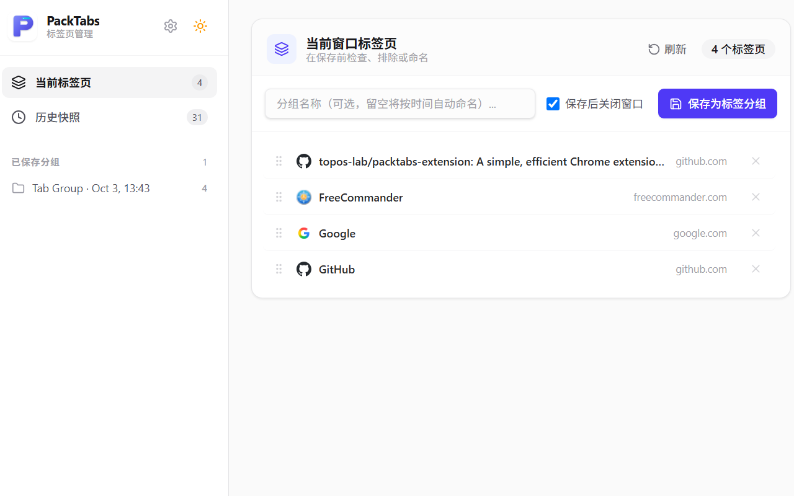
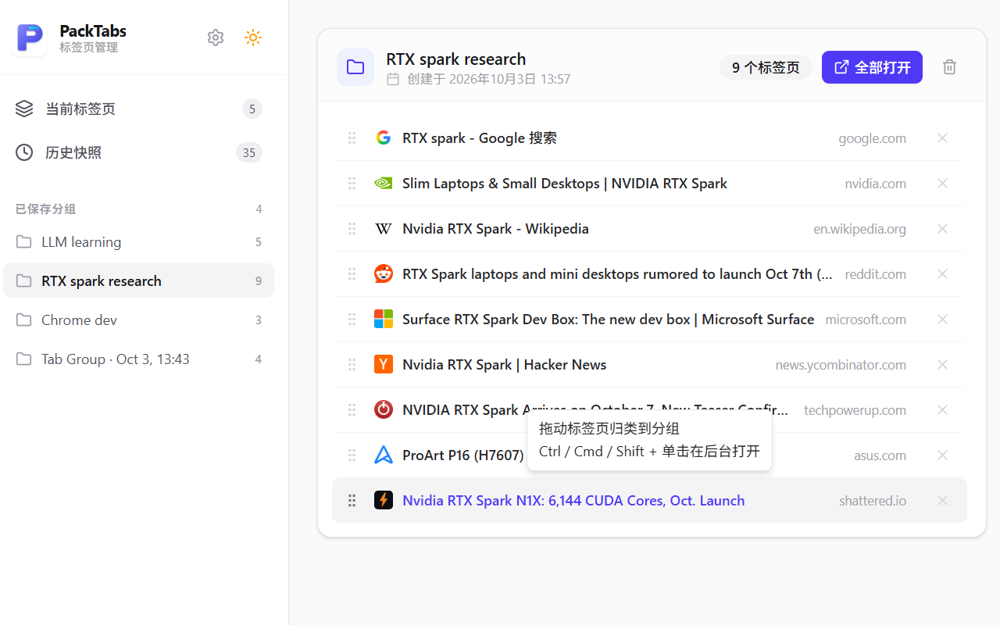
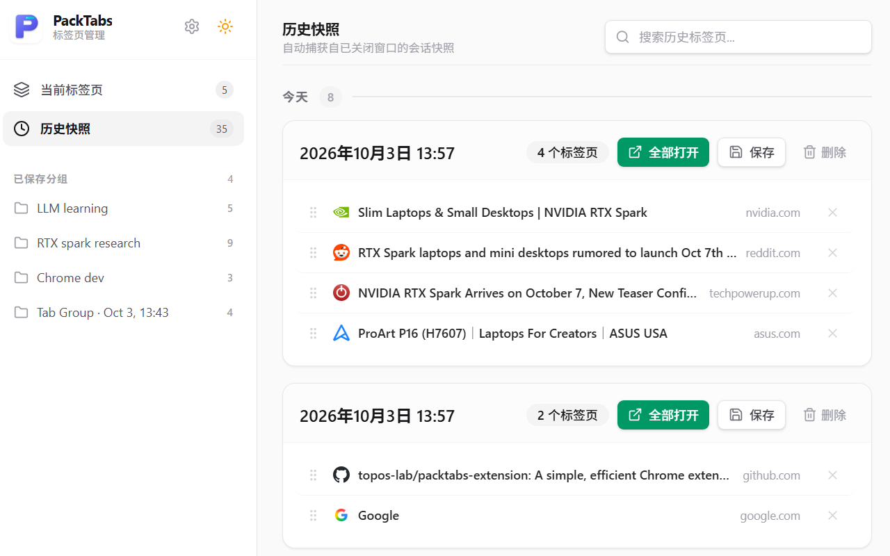
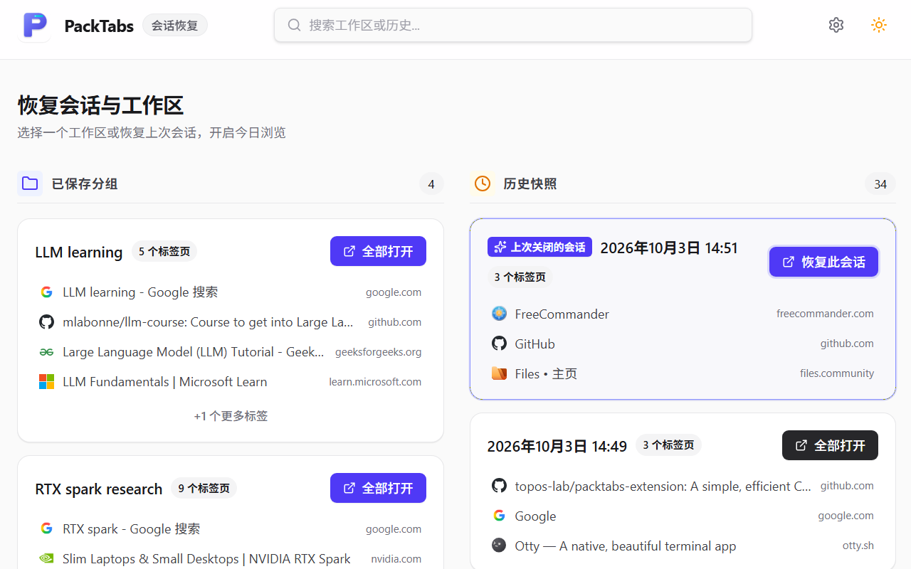
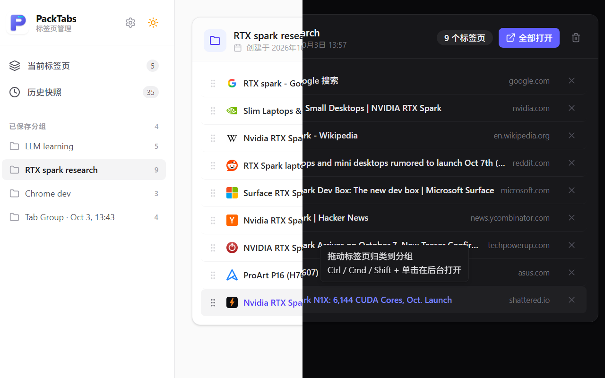

#  PackTabs 用户使用指南与功能图解 (User Guide)

🌐 **语言 / Language**: [English](USER_GUIDE.md) | 简体中文

> **版本**：v1.6.0  
> **适用平台**：Google Chrome / Mozilla Firefox / Microsoft Edge 及其他 Chromium 内核浏览器  
> **商店直达**：[Chrome 应用商店](https://chromewebstore.google.com/detail/packtabs/mpjjbfgjjbphemiklfoojlogcmjdkjjp) | [Firefox 附加组件商店](https://addons.mozilla.org/zh-CN/firefox/addon/packtabs-task-tab-manager/)

---

## 一、为什么需要 PackTabs？

在日常工作和研究中，我们常常陷入两种糟糕的体验：

1. **不敢关浏览器**：正在进行的工作/论文调研/项目查阅未完成，浏览器常年挂着 30~80 个标签页，严重占用电脑内存并干扰视线。
2. **书签栏沦为垃圾场**：把临时要看的网页一股脑存入书签栏，过后既难找又舍不得删，导致真正的高频核心书签被严重淹没。

**PackTabs 的解决方案**：
面向**任务（Task-Oriented）**设计的标签页与工作区管理器。做完一个阶段，一键将当前窗口的全部网页打包封存，随时瞬间原样还原；临时任务与永久书签彻底解耦，还你一个干净、专注的工作区。

---

## 二、快速上手 (Quick Start)

### 1. 唤出 PackTabs

- **点击工具栏图标（轻量快速面板）**：点击浏览器右上角 **PackTabs** 图标（，若未显示请从“拼图”🧩固定）：
  - 点击顶部 **【保存当前窗口标签页】**，直接在当前窗口打开「当前标签页」视图进行打包；
  - 点击下方任意**已保存分组名称**即可在当前窗口一键打开（按住 `Shift` 点击或点击右侧 `↗` 图标则在新窗口打开）。
- **全局快捷键**（直达完整管理面板）：
  - Windows / Linux：`Alt + Shift + K`
  - macOS：`Command + Shift + K`

> [!TIP]
> 如果您想修改快捷键，可在 Chrome 地址栏输入 `chrome://extensions/shortcuts` 进行自定义配置。也可以通过这个扩展的设置界面点击跳转到相关页面进行配置。

---

## 三、六大核心功能指南 (Core Features)

---

### 功能 1：当前窗口检视与一键打包 (Staging & Save)

#### 📖 功能说明

打开 PackTabs 后，首先看到的是【当前窗口标签】视图：

- **实时预览**：按 URL 字母顺序整洁列出当前窗口所有打开网页，直观显示 Favicon、标题和域名。
- **排除单个网页**：点击右侧 `✕` 图标即可剔除不需要的网页；若不小心点错，可通过右下角 5 秒通知内的【撤销】即时恢复。
- **自定义命名**：在输入框为任务命名（如 `LLM learning`、`RTX spark research`）；若留空，系统会自动生成智能时间戳名称。
- **保存与窗口退出开关**：在主按钮旁可直接切换**「保存后关闭窗口」**开关——默认开启，按钮文案同步显示为**【保存并退出】**，点击即可存组并自动关闭当前窗口。

_图 1：一键打包当前任务标签页，释放内存，清爽视界_

---

### 功能 2：工作区一键复原、双模式打开与静默加载 (Restore & Tab Operations)

#### 📖 功能说明

在左侧菜单栏切换到任一【已保存分组】：

- **当前窗口 / 新窗口双模式恢复**：点击**【全部打开】**会在当前窗口批量恢复（按住 `Shift` 点击则在新窗口打开）；点击紧邻的 `↗` 图标按钮可直接打开一个聚焦的新窗口。
- **单独在后台静默打开某页面**：按住键盘 `Ctrl`（或 `Cmd` / `Shift`）点击某网页，或直接**鼠标中键**点击，将在后台标签页静默打开。
- **行内编辑与无弹窗撤销删除**：悬停卡片头部可点击编辑图标重命名；点击垃圾桶图标将直接删除，并在 5 秒内支持点击右下角通知【撤销】找回。

_图 2：随时瞬间还原整个任务工作区，支持后台静默打开单个标签_

---

### 功能 3：自动历史快照 (Automatic History Snapshots)

#### 📖 功能说明

如果不小心直接点了浏览器右上角大红叉 `✕` 关掉了整个窗口怎么办？

- **自动防丢机制**：PackTabs 内置后台监听服务，当检测到某个窗口关闭时，会自动将其中打开的网页去重捕获为【历史快照】。
- **从不丢失会话**：在左侧进入【历史快照】列表，按今天、昨天、过去 7 天清晰归档。
- **行内转存为分组**：鼠标滑过任意历史卡片头部，点击标题右侧的书签加号图标即可在原地展开输入框，回车保存为永久分组。

_图 3：窗口意外关闭？自动快照完整记录关闭时段标签，一键找回或保存为分组_

---

### 功能 4：浏览器启动恢复页 (Startup Restorer)

#### 📖 功能说明

每天早晨打开电脑启动浏览器时，快速接着昨晚未做完的任务继续：

- 在设置中开启【浏览器启动时恢复】。
- 冷启动打开新浏览器时，PackTabs 会自动弹出简洁双栏启动页，高亮突出您的**【上次关闭的会话】**与所有**已保存分组**。
- 点击**恢复此会话**或**全部打开**（或右侧 `↗` 在新窗口打开）即可衔接工作流；按 `/` 可快速搜索，悬停卡片头部可就地转存/删除（支持 5 秒撤销），也可以直接把标签拖入左侧已保存分组归类。

_图 4：开启浏览器即刻继续未竟任务，无缝切换工作上下文_

---

### 功能 5：直观拖拽归类 (Drag & Drop Stashing)

#### 📖 功能说明

- **自由归类**：在管理页按住标签行左侧拖拽手柄（`⋮⋮`）拖到侧边栏分组，或在启动恢复页直接拖动任意标签行至左侧已保存分组卡片（历史标签拖过去为「复制归档」，不删历史；已保存分组互拖则自动「移动」）。
- **即时视觉反馈**：拖动经过目标分组时自动显示高亮虚线/紫框提示。

---

### 功能 6：深浅色自适应与 100% 离线隐私 (Theme & Privacy)

#### 📖 功能说明

- **主题自适应切换**：点击右上角图标支持【跟随系统 / 浅色 / 深色】三态切换，涵盖管理页、工具栏快速面板、自定义 Tooltip 与中性浮层 Toast 通知，首帧同步应用主题不闪白。
- **100% 离线运行与本地安全**：所有网页标题、地址全部保存在您本机浏览器的 10MB 独立沙箱中，零网络请求、零第三方追踪。

_图 5：明亮与暗黑护眼模式双向无缝切换，界面纯净舒适_

---

## 四、常用技巧速查表

| 操作                 | 快捷方式 / 操作方法                             | 作用                                     |
| :------------------- | :---------------------------------------------- | :--------------------------------------- |
| **打开工具栏快速面板** | 点击扩展图标                                    | 1 键打包当前窗口或直达打开已保存分组       |
| **打开/聚焦管理面板** | `Alt + Shift + K` (Mac: `Cmd + Shift + K`)      | 在当前活动窗口唤出或聚焦完整管理看板     |
| **在新窗口全部打开** | 点击 `↗` 图标或按住 `Shift` 点击【全部打开】    | 新建独立窗口恢复整个分组                 |
| **后台静默打开网页** | `Ctrl` / `Cmd` / `Shift` + 点击（或鼠标中键）   | 不切换焦点，在后台标签页加载网页         |
| **启动页快捷搜索**   | 启动恢复页按 `/` 唤出，`Esc` 关闭               | 实时过滤已保存分组与历史快照             |
| **误删即时撤销**     | 删除或剔除后点击右下角通知中的【撤销】          | 5 秒内一键恢复整组、单条标签或转存状态   |
