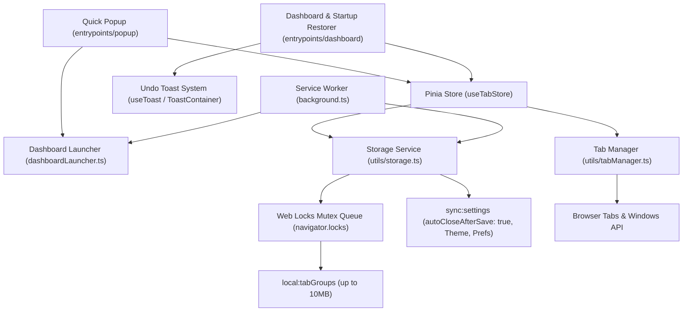

# Design Document: Tab Group Manager

## Overview

PackTabs is a Chrome & Firefox Manifest V3 extension built with the WXT Framework, Vue 3 Composition API, Pinia 4, Tailwind CSS v4, and Radix Vue. Its architecture cleanly separates the background service worker (`entrypoints/background.ts`), the lightweight action popup (`entrypoints/popup/`), the full Dashboard & Startup Restorer (`entrypoints/dashboard/`), mutex-locked persistence (`utils/storage.ts`), and browser tab/window services (`utils/tabManager.ts`).

## Technology Stack

- **[WXT Framework](https://wxt.dev/)**: Modern web extension framework providing unified `browser.*` APIs, multi-entrypoint HTML bundling (`dashboard` + `popup`), and Vite 8 bundling.
- **[Vue 3](https://vuejs.org/)**: Composition API (`<script setup>`) reactive UI components.
- **[Tailwind CSS v4](https://tailwindcss.com/)**: CSS engine with custom `.dark` variant and softened neutral Zinc surfaces (`#ffffff`/`#fafafa` in light mode, `#222226`/`#18181b` in dark mode).
- **[Radix Vue](https://www.radix-vue.com/)**: Headless accessible primitives (`DialogRoot`, `TooltipRoot`, `Portal`) with `disable-hoverable-content` and conditional `aria-describedby` handling.
- **[Lucide Vue Next](https://lucide.dev/)**: Tree-shakeable SVG icons (`ExternalLink`, `BookmarkPlus`, `Trash2`, `Layers`, `Clock`, `Folder`, `SunMoon`, etc.).
- **[TypeScript](https://www.typescriptlang.org/)**: Strict type-safe models, storage schemas, and component props.
- **[Pinia 4](https://pinia.vuejs.org/)**: Reactive store (`useTabStore`) backed by Web Locks storage persistence.
- **[Bun](https://bun.sh/)**, **[Vitest 5](https://vitest.dev/)**, & **[fast-check](https://fast-check.dev/)**: Fast runtime, unit tests, and property-based tests.

## Project Structure

```
packtabs-extension/
├── entrypoints/
│   ├── background.ts              # Service worker (session tracking, cold-start recovery, shortcut launch)
│   ├── popup/                     # Compact 280px Quick Action Popup
│   │   ├── App.vue                # "Save current window tabs" launcher + Saved Groups name list
│   │   ├── index.html             # Popup HTML shell
│   │   ├── main.ts                # Popup bootstrap
│   │   └── style.css              # Compact popup Tailwind v4 styles
│   └── dashboard/                 # Management Dashboard & Startup Restorer
│       ├── App.vue                # Main 2-pane dashboard shell & Current Tabs staging
│       ├── main.ts                # Dashboard bootstrap
│       └── style.css              # Global Tailwind v4 theme & scrollbar styles
├── components/
│   ├── ui/                        # Reusable accessible UI primitives
│   │   ├── badge/                 # Badge component (cva variants)
│   │   ├── button/                # Button component (cva variants)
│   │   ├── card/                  # Card, CardHeader, CardContent
│   │   ├── dialog/                # Accessible Modal (Radix Vue Dialog with contentClass)
│   │   ├── input/                 # Input component
│   │   ├── toast/                 # Neutral ToastContainer with semantic icons & Undo action
│   │   └── tooltip/               # Theme-aware 300ms Tooltip (Radix Vue, zero animation)
│   ├── CollectionDetail.vue       # Dedicated saved group detail view
│   ├── SettingsModal.vue          # Compact scroll-free preferences modal (5 settings)
│   ├── StartupRestorer.vue        # Distraction-free 2-column startup restorer + header-hover tools
│   ├── StartupTabList.vue         # Reusable collapsible tab preview list for Startup Restorer
│   ├── TabGroupCard.vue           # Interactive history group card with title-adjacent inline save
│   ├── TabGroupList.vue           # Time-categorized history list
│   └── TabItemRow.vue             # Dashboard tab row (persistent GripVertical & aligned ×)
├── stores/
│   └── useTabStore.ts             # Pinia store with restoreGroup, convertToNamed, addTab, moveTab
├── composables/
│   ├── useGroupActions.ts         # Shared open, 5s Undo delete, history convert & drag-drop actions
│   ├── useI18n.ts                 # Runtime en / zh_CN / zh_TW i18n
│   ├── useSettings.ts             # Synchronized sync:settings state
│   ├── useTheme.ts                # Tri-state theme manager + localStorage pre-paint cache
│   └── useToast.ts                # Floating toast state with 5s Undo action & pause/resume timers
├── utils/
│   ├── dashboardLauncher.ts       # Target-window resolution & per-window dashboard launch
│   ├── storage.ts                 # Mutex-locked storage, TTL tombstones & tombstone clearing
│   ├── tabManager.ts              # URL sorting, current/new-window tab restoration, MV3 favicon
│   └── init-app.ts                # Shared Vue/Pinia app bootstrap
├── types/
│   ├── env.d.ts                   # Build-time __APP_BUILD_TIME__ type declaration
│   ├── TabGroup.ts                # TypeScript domain models
│   └── Storage.ts                 # WXT storage schemas & keys (autoCloseAfterSave: true default)
├── tests/
│   ├── unit/                      # Component, store, popup, & utility unit tests
│   └── property/                  # fast-check property-based tests
├── public/
│   ├── icon/                      # Extension icons
│   └── _locales/                  # Minimal 4-key Manifest i18n files
└── wxt.config.ts                  # WXT configuration (action title/icon + open_dashboard shortcut)
```

## System Architecture



### 1. Presentation Layer

- **Quick Action Popup (`entrypoints/popup/App.vue`)**: Compact `280px` (`w-full min-w-[280px]`) panel triggered by the toolbar icon, applying cached theme before mount (`applyCachedTheme`) and filling `html`/`body` dark surfaces to eliminate dark-mode outer white frames. Provides a single-click "Save current window tabs" action at the top and a clean name-only list of Saved Groups below (click name for current window, `Shift+Click` or `↗` icon button for a new window).
- **Dashboard Layout (`entrypoints/dashboard/App.vue`)**: Clean two-pane layout (`h-14` sidebar header + main workspace) free of sidebar count badges and redundant tab-count text. Current Tabs integrates an inline "Close window after save" switch directly beside the primary Save button, switching the CTA dynamically between "Save & Exit" (`保存并退出`) and "Save as Tab Group" (`保存为标签分组`). The About modal omits duplicate brand cards and footer buttons, rendering `(dev · YYYY-MM-DD HH:mm)` alongside odd-minor development versions via `__APP_BUILD_TIME__`.
- **Scroll-Free Settings (`components/SettingsModal.vue`)**: Uses `max-w-lg` width, `divide-y` spacing, single-row language buttons, compact horizontal startup guidance banner, and hosts the 5 global preferences (Theme, Language, Restore on Startup, History Limit, Shortcut) without redundant descriptions or footer Close buttons.
- **Scheme A Dual-Open Action Pair & Alignment**: Across `CollectionDetail.vue`, `TabGroupCard.vue`, and `StartupRestorer.vue`, primary restoration buttons use clean text-only labels ("Open All" / "Restore Session") for current-window opening (`Shift+Click` for new window), paired with a borderless, backgroundless `ExternalLink` (`↗`) icon button; Dashboard card/row delete icons align vertically at exact `30px` centers.

### 2. State, Undo Toast & Concurrency Layer

- **Neutral Undoable Toast Lifecycle (`composables/useToast.ts`, `ToastContainer.vue`)**: Renders neutral theme-matched floating cards (`bg-white` / `dark:bg-[#27272c]`) with semantic status icons (`emerald` / `rose` / `indigo`) and crisp Indigo action buttons (`life: 5000`, hover pause/resume timers, single-fire `triggerAction` cleanup).
- **Deletion & Conversion Undo (`stores/useTabStore.ts`, `utils/storage.ts`)**:
  - Group and tab deletions execute immediately without confirmation modals, capturing a plain-object snapshot beforehand (`Proxy`-safe via `normalizeTabs` + `Date` cloning).
  - Undoing a deleted group calls `tabStore.restoreGroup(snapshot)`, which clears any matching TTL tombstone via `clearDeletedHistorySignature` before persisting back to `local:tabGroups` with its original ID and timestamp.
  - Undoing a single deleted tab calls `tabStore.addTab(groupId, deletedTab)` (or `restoreGroup` when removing the last tab auto-deleted a history snapshot).
  - Undoing an inline history-to-named conversion reverts `name` and sets `isHistory: true`.
- **Storage Segregation & Mutex Serialization**: `local:tabGroups` stores tab collections; `sync:settings` stores user preferences with `autoCloseAfterSave: true` by default; all writes serialize across contexts via named `navigator.locks` mutexes.

### 3. Tab, Window & URL Sorting Layer (`utils/tabManager.ts`)

- **Normalized URL Sorting (`getTabUrlSortKey`, `sortTabsByUrl`)**: Strips scheme (`http`/`https`) and leading `www.` to sort tabs consistently by host, port, path, query, and hash across Current Tabs, Saved Group Detail, History Snapshots, Startup Restorer, and Popup group launches.
- **New-Window Launching (`openTabsInNewWindow`)**: Filters valid `http`/`https` URLs and launches all tabs together via `browser.windows.create({ url: validUrls, focused: true })`.
- **Per-Window Dashboard Scoping (`utils/dashboardLauncher.ts`)**: Resolves the active normal browser window so launching Current Tabs from the Popup or `open_dashboard` shortcut (`Alt+Shift+K` / `Command+Shift+K`) never hijacks another window's dashboard.

### 4. Startup Session Restorer (`components/StartupRestorer.vue`)

- **Minimalist 2-Column View**: Shows Saved Groups (left) and History Snapshots (right) with soft Indigo emphasis on the latest closed session, hiding per-card counts and row domains, expanding collapsed search only via icon toggle or `/`, showing up to 9 tabs inline before collapsing at 10+ (`MAX_VISIBLE_TABS = 8`), and presenting drag-to-group + shortcut tips in the borderless footer.
- **Unobtrusive Header-Hover Organization & Flush Open Actions**:
  - **Cards**: Hovering or `:focus-visible` inside `CardHeader` reveals management icons grouped right beside card titles (`Trash2` delete on Saved cards; `BookmarkPlus` + `Trash2` on History cards) using `group-has-[:focus-visible]` and `.blur()` on drag so hover buttons never stick after mouse drags; `[Open All / Restore Session]` and `[↗]` remain flush right without reserved blank gaps.
  - **Tab Rows**: Rendered with sibling open and `×` delete `<button>`s (`data-delete-tab` aligned with header padding, revealed on hover / `group-has-[:focus-visible]`) without persistent drag handles while keeping `draggable="true"` active.
  - **Drag-and-Drop**: Tracks `draggingSourceIsHistory` so `dragover.dataTransfer.dropEffect` matches `effectAllowed` (`copy` for History → Saved, `move` for Saved → Saved), preventing browser drop rejection while copying from history or moving between saved groups.

## Testing Strategy

- **Unit Testing**: Vitest with `@vue/test-utils` covering `StartupRestorer`, `TabGroupCard`, `TabGroupList`, `SettingsModal`, `Popup`, `useToast`, `useTabStore`, `tabManager`, `storage`, and `dashboardLauncher`.
- **Property-Based Testing**: `fast-check` validating storage round-trips, timestamp sorting, group isolation, deletion/conversion invariants, and multi-tab integrity.
